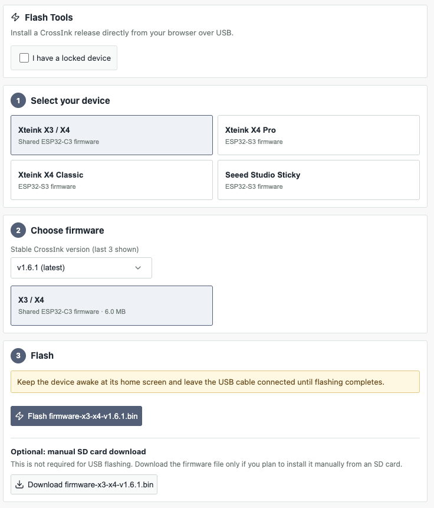

# For teeny tiny ereader

A quick guide to updating firmware, managing books, and downloading EPUBs for your Teeny Tiny eReader.

## Updating Firmware

There are two ways to update the firmware.

### Option 1: Update Directly from the Device

> ⚠️ **Prerequisite:** Connect your device to Wi-Fi via **Settings → System → WiFi Networks**.

1. Open **Settings**.
2. Select **System**.
3. Select **Check for updates**.

Follow the on-screen instructions to install any available updates.

### Option 2: Update Using the Online Flash Firmware Tool

You can install a Crossink firmware release directly from your browser using the [Crossink Flash Firmware Tool](https://inky.crossink.dev/#flash-tools).

1. Open the [Flash Firmware Tool](https://inky.crossink.dev/#flash-tools).
2. Make sure the correct options are selected for your device.
3. Click **Flash firmware**.
4. Follow the on-screen instructions to complete the process.

> ⚠️ **Important:** It's best to remove the case before flashing the firmware. You'll need access to the device's reset button, which is blocked by the case.

## Adding and Removing Books

There are two ways to manage books on your eReader.

### Option 1: Transfer Using the SD Card

1. Remove the SD card from the eReader.
2. Insert it into your laptop using an SD card reader.
3. Drag and drop book files onto the SD card to add them.
4. Delete files from the SD card to remove books.
5. Safely eject the SD card and reinsert it into the eReader.

### Option 2: Transfer Books Wirelessly

> ⚠️ **Prerequisite:** Connect your device to Wi-Fi via **Settings → System → WiFi Networks**.

1. On your eReader, open **File Transfer**.
2. Select **Join a Network**.
3. On a device connected to the same network, open [http://crosspoint.local/](http://crosspoint.local/).
4. Open **File Manager** to upload new books or delete existing ones.
5. You can also adjust your eReader's settings from the Crosspoint web interface, which may be easier than changing them directly on the device.

### Option 3: Transfer Using Calibre

Calibre is a library management tool that offers another way to manage and transfer books. However, it requires additional setup and can be temperamental, so this guide focuses on the two simpler methods above.

## Downloading Books (EPUBs)

Here are some places to find EPUB books.

| Website | Cost | Link |
|---|---|---|
| ebooks.com | Paid | [Visit ebooks.com](https://www.ebooks.com/en-gb/) |
| Kobo | Paid | [Visit Kobo](https://www.kobo.com/gb/en) |
| Anna's Archive | Free sources may be available | [Read the Wikipedia overview](https://en.wikipedia.org/wiki/Anna%27s_Archive) |

### Finding Anna's Archive

1. Visit the [Anna's Archive Wikipedia page](https://en.wikipedia.org/wiki/Anna%27s_Archive).
2. Find the links to Anna's Archive on the page.
3. Follow a link to visit the site.

